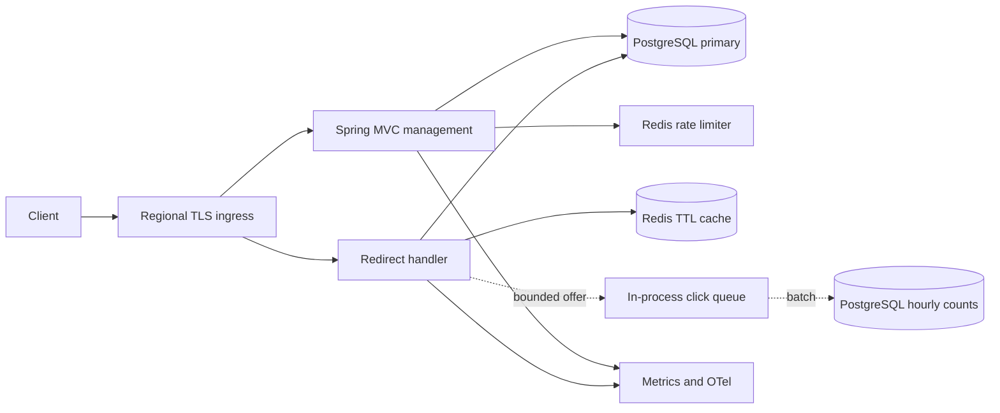
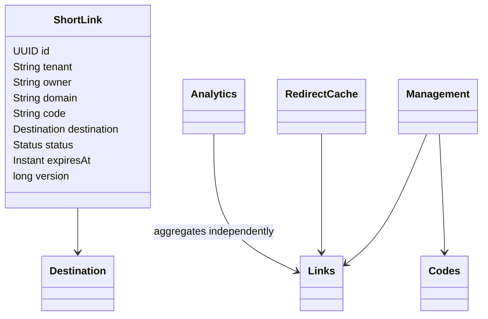

# Requirements and architecture

Acceptance: unique domain/code assignment; durable transaction before 201; idempotency replay after response loss;
unauthorized tenant cannot observe links; expired/nonactive links never redirect once observed; version conflicts
yield 409. Target 99.99% availability and regional p99 <20 ms are unverified. Measure from regional ingress receipt
through response headers, including LB and dependencies, excluding client/internet. Track server failures and latency
separately from intentional 404/410/451 outcomes.

Start in one region across three AZs. Planning geography: 60% home region, 25% second region, 15% third; initial remote
traffic reaches home region. Assume 100:1 reads/writes for planning, but the stated peak write/read ranges are separate
workload envelopes. Assume Zipf-like popularity (exponent 1.1 to be validated), 99% hits, 100M initially retained
records, 20% active/hot, 90-day default retention planning only: implementation has no default expiration and keeps
reservations indefinitely.

## Alternatives

A modular monolith minimizes coordination and supports atomic writes. Deploy identical artifacts in separate pools with
ingress routing to scale reads and management separately. B separates redirect/write services when measured CPU, deploy
cadence or blast radius justifies it. C adds global edge routing, regional caches and replicas for millions of reads:
replication lag and invalidation become explicit product constraints. A is the implemented starting point; it alone does
not establish the target throughput. MVC with virtual threads fits blocking JDBC/Lettuce; pool and ingress limits remain
essential. WebFlux would require a consistently nonblocking stack and measured benefit; virtual threads do not make
database calls free.

PostgreSQL failure rejects writes and cache misses with 503; cached entries can continue for their TTL. Redis failure
bypasses the redirect cache but creation fails closed because quotas require Redis. Analytics overflow and flush
failures lose events and increment counters. A full DB outage amplifies misses; ingress must shed load rather than retry
indefinitely. No application retries except eight random-code attempts. Driver/pool timeouts bound waits.

## Correctness and transactions

One tenant row is locked during create, serializing that tenant's quota and idempotency operations. This deliberately
limits very large tenant write throughput. `ON CONFLICT(domain,code) DO NOTHING` allows bounded retry without aborting
the transaction. All link, audit and idempotency inserts commit together; the exact response is retained indefinitely
for replay. Same key with a different normalized DTO fingerprint is 409, also after expiration/deletion. Key scope
includes owner to avoid disclosing another user's response. No canonical URL deduplication. A unique constraint is the
authority; random generation is not a uniqueness guarantee.

Updates use compare-and-swap version in the same transaction as audit. Ownership columns are immutable. Delete requires
the current version and preserves the reservation forever. BLOCKED changes require tenant administrator role; DELETED is
terminal; blocked links require admin for further changes. Expiration is derived rather than materialized, avoiding
scheduler races; a future expiration PATCH can reactivate an expired ACTIVE record. A redirect already authorized
immediately before disable can complete.

## Cache consistency

Cache-aside keys `shortlink:{domain}:{code}` hold the entire immutable snapshot, including status, expiry and version.
No negative caching: a missed alias cannot hide a new reservation. No post-write eviction: TTL is the propagation
mechanism, avoiding claims that eviction solves concurrent stale fills. DB-read elapsed time is deducted from the
two-second TTL. Redis command/network scheduling delay adds uncertainty; this is a soft operational staleness bound, not
a hard real-time guarantee. Monitor command delay. Expiration is always evaluated at redirect time. No stale serving
after expiry. A stale cached ACTIVE record can still redirect after block/delete until TTL expiry. Use
`STRICT_REDIRECTS=true` everywhere for abuse-sensitive deployment, with primary reads and associated capacity cost; do
not enable edge caching there. No global revocation guarantee for responses already in flight.

Redis outage increases primary load; short TTL and hot keys demand protection at ingress. Production should separate
rate-limit Redis (noeviction, durable/HA per quota needs) from evictable cache Redis; the current adapter uses one
instance, so eviction can reset window limits. Redis cluster Lua touches only one hashed key. No
near-cache/single-flight exists yet; DB fallback must be admission-controlled externally.

## Code strategy

Random CSPRNG Base62, length 10: opaque, no coordination apart from unique primary. Uniform `nextInt(62)` avoids modulo
bias. At n retained records in space N collision probability per insertion is n/N, birthday probability at least one
historical collision approximately 1-exp(-n(n-1)/(2N)). Eight attempts then 503; occupancy must be monitored and length
increased before saturation. Existing codes remain valid after expansion.

| Strategy             | Uniqueness / length                                | Operations and risk                                         |
|----------------------|----------------------------------------------------|-------------------------------------------------------------|
| Sequential ID Base62 | unique, variable <=11 for signed long              | primary sequence coordination; easy enumeration             |
| Snowflake Base62     | unique only with worker/clock discipline, about 11 | worker leases and clock rollback failure                    |
| Random Base62        | constraint plus retries, 10                        | opaque; collisions expected at scale                        |
| UUID-derived         | full UUID large; truncation collides               | truncation loses uniqueness; still needs constraint         |
| URL hash             | deterministic, collisions                          | canonicalization/privacy and tenant ownership complications |
| Code pools           | unique with transactional leases                   | pool refill, stranded ranges, allocation complexity         |

Base62 is URL-path friendly without Base64 padding or slash; hex needs longer strings for equal entropy. Obfuscating
sequential IDs hides obvious order but does not provide authorization. Links remain publicly accessible bearer
identifiers, not secrets.

## Domain model

UUID primary keys avoid central application ID generation; their random index locality costs space. BIGINT improves
compactness/locality but needs sequence routing at shard scale. Lookup uniqueness is domain/code, not globally code
alone. An identical code on two domains is safe. No table partitioning initially: time partitioning conflicts with
global domain/code uniqueness unless an independent reservation directory exists. At billions of links, hash-shard by
domain/code with an immutable reservation directory and routing epoch. Backfill, dual-read compare, then switch writes
with fencing; never allow two writable authorities for the same shard.

## Multi-region extension

Single writer plus edge cache is simplest, but newly created links wait for replica replay and edge miss routing.
Active-passive uses synchronous local-AZ replication, async inter-region replication and explicit failover RPO.
Active-active requires globally serialized reservations or disjoint region code prefixes plus a strongly consistent
custom-alias directory; PostgreSQL replicas alone cannot arbitrate conflicts. During partitions prefer rejecting writes
over duplicate alias assignment. Route recent misses to primary; cap negative cache TTL if later introduced. Block
propagation needs a signed revocation feed with acknowledgement and deny-on-stale replicas, or authoritative checks; DNS
failover cannot promise immediate switching because clients cache DNS. Respect data residency by routing tenant
writes/analytics to the assigned region.

## Dependencies

Spring Boot 3.5.16 BOM manages JDBC, Security, Lettuce, Flyway, Micrometer and Testcontainers versions. Java 21
compatibility verified against [official requirements](https://docs.spring.io/spring-boot/3.5/system-requirements.html).
Staying on the repository's 3.5 baseline avoids an unrelated major-version migration; upgrades and CVE scanning remain
release gates. PostgreSQL 17 and Redis 7.4 images need immutable digests and current security patch selection before
release.
